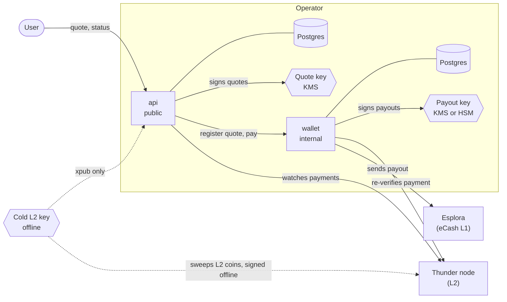

# Fast withdrawals

Fast withdrawals from eCash (ECX) sidechains back to the eCash main chain.

eCash is a Bitcoin-derived chain with drivechains (BIP300/301). Moving coins
from a sidechain (L2) back to eCash (L1) normally means waiting for a
withdrawal bundle to be approved on L1, which takes a long time. This service
skips the wait: you pay it ECX on the sidechain, and it pays you ECX on L1
right away, minus a fee. The operator fronts the L1 liquidity and collects
the L2 coins.

It supports the [Thunder](https://github.com/LayerTwo-Labs/thunder-rust)
sidechain today.

## How it works

1. **Quote.** You ask for a withdrawal of some amount to your L1 address. The
   service returns a signed quote: an L2 address to pay, the exact amount, and
   a deadline.
2. **Pay.** You pay the L2 address.
3. **Payout.** Once the payment has enough L2 confirmations, the service sends
   your coins on L1.

Underpaid withdrawals aren't paid out, and can be refunded on request.

## Using a running service

The API is [Connect](https://connectrpc.com), so it works over gRPC and
plain HTTP/JSON. The schema is in
[`proto/fastwithdraw/v1/fastwithdraw.proto`](proto/fastwithdraw/v1/fastwithdraw.proto),
and servers expose it through reflection:

```sh
buf curl https://<host>/fastwithdraw.v1.FastWithdrawalService/GetStatus
```

`GetServiceInfo` gives the fee, payout limits and the key quotes are signed
with; `GetStatus` says whether withdrawals are accepted right now.

## Architecture



- **api** is the only public service. It quotes withdrawals, derives a fresh
  L2 payment address for each from an xpub, watches the sidechain for
  payments, and asks the wallet to pay out.
- **wallet** holds the L1 hot wallet. It doesn't verify callers itself:
  keep it on a private network that only the api and the scheduler reach (on
  Google Cloud, Cloud Run IAM does this, and the wallet then admits the api
  to everything and the scheduler only to `Tick`). It pays only what was registered
  when the quote was made, and checks the L2 payment against Thunder itself,
  so a compromised api can't redirect or invent payouts. Daily caps limit
  what it can lose.
- **Background work** runs when a scheduler calls `Tick` on each service,
  eg. once a minute. The api's internal methods (`Tick`, and listing
  paid indexes for sweeps) need the operator token (`API_INTERNAL_TOKEN`) as
  `Authorization: Bearer`, or on Google Cloud (`-gcp` images) the
  scheduler's ID token.
- **Keys** never leave their KMS or HSM in production. The key that spends
  the collected L2 coins stays offline; only its xpub is deployed.

## Running your own

The services are published as images, `ghcr.io/layertwo-labs/fastwithdraw-api`
and `ghcr.io/layertwo-labs/fastwithdraw-wallet`, and run anywhere containers
do. They need Postgres, a Thunder node, an Esplora server for eCash, and a
KMS or HSM for the signing keys. The plain image tags support any
[PKCS#11 HSM](rust/docs/pkcs11.md) for the payout key; the `-gcp` tags
also support Google Cloud KMS for both keys and Cloud Scheduler's ID tokens
(the `gcp-kms` and `gcp-auth` build features).
For development, keys can be given as environment variables. Create the cold
L2 key on an offline machine with
`cargo run -p fastwithdraw-thunder-keys --bin thunder-xpub -- new`, which
prints the xpub the services need. Every setting is an environment variable;
see `--help` on each binary.

## Development

Needs Rust, [just](https://github.com/casey/just), [buf](https://buf.build)
and, for the integration tests, SoftHSM (`brew install softhsm`).

```sh
just test       # clippy and unit tests
just test-it    # integration tests against a local regtest stack
just proto      # regenerate code after editing proto/
```

On first run, the integration tests download bitcoind, the BIP300/301
enforcer and Thunder and build electrs, and run them alongside the services.
